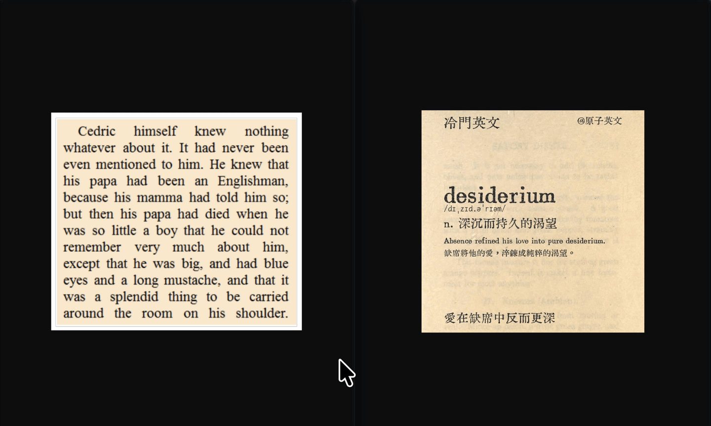

# Vision OCR for Alfred

<p align="center">
  
</p>

<p align="center">
  <strong>Lightning-fast (~15ms), 100% offline, on-device Apple Vision OCR for Alfred.</strong><br>
  Clipboard-first • Zero disk I/O • Zero cloud dependencies • Multi-language (CJK + English)
</p>

<p align="center">
  <a href="https://github.com/xzy9565/alfred-vision-ocr/releases"></a>
  <a href="LICENSE"></a>
  
  
</p>

<p align="center">
  
</p>

---

## ⚡ Why Vision OCR?

Most existing OCR workflows for Alfred either:
1. **Force an interactive screen selection every single time**, even when you already have an image copied to your clipboard from WeChat (`⌥A`), CleanShot X, Snipaste, or your web browser.
2. **Depend on third-party cloud APIs** (Baidu, Tencent, OpenAI), requiring tedious API key setups, usage quotas, network latency, and **leaking sensitive clipboard screenshots to third-party servers**.
3. **Depend on macOS Shortcuts (`shortcuts run`)**, causing 2-3 second startup latency and annoying permission dialogs.
4. **Write uncompressed image files to `/tmp`**, triggering clipboard race conditions with compression tools like Clop.

**Vision OCR is built from first principles:**
- **Clipboard-First**: Reads directly from `NSPasteboard` in system memory via Cocoa AppKit. If your clipboard already holds an image, it extracts text in **~15ms** with **zero disk I/O**.
- **Interactive Screen Capture Fallback**: If the clipboard does not currently contain an image, it automatically brings up macOS interactive crosshairs (`screencapture -i`).
- **100% On-Device & Private**: Driven by Apple's native `Vision.framework`. No internet connection required, zero tracking, zero API keys.
- **Multi-Language Out of the Box**: Automatically detects and recognizes **English**, **Simplified Chinese**, **Traditional Chinese**, **Japanese**, and **Korean**.

---

## 🚀 Performance Comparison

| Metric | Cloud API OCR (Baidu/OpenAI) | Shortcuts OCR (`shortcuts run`) | Alfred Team Multi OCR | **Vision OCR (This Workflow)** |
| :--- | :---: | :---: | :---: | :---: |
| **Response Time** | 800ms - 2,500ms | 1,500ms - 3,000ms | 300ms - 800ms | **⚡ ~15ms** |
| **Direct Clipboard OCR** | Varies | ❌ (File / Capture) | ❌ (Interactive capture only) | **✅ Yes (In-Memory)** |
| **Disk I/O** | Writes `/tmp` | Writes temporary files | Writes temporary files | **✅ Zero (Direct Memory)** |
| **Network Required** | Yes (Cloud API) | No | No | **✅ No (100% Offline)** |
| **Privacy / Leaks** | ⚠️ Uploads to server | Local | Local | **🛡️ 100% Local Apple Vision** |

---

## 📦 Installation

1. Download the latest **`Vision-OCR.alfredworkflow`** from [GitHub Releases](https://github.com/xzy9565/alfred-vision-ocr/releases/latest).
2. Double-click the downloaded file to install it into **Alfred 5**.
3. (Optional) Customize the hotkey in Alfred Preferences (default is `Ctrl + F4`).

---

## ⌨️ Usage

### 1. Clipboard-First OCR (Recommended)
Take a screenshot using your favorite screenshot utility (WeChat, CleanShot X, Snipaste, Shottr, or browser right-click "Copy Image"):
- Press **`Ctrl + F4`** (or invoke Alfred and type `ocr`):
- Text is recognized in **~15ms** and automatically copied to your clipboard.
- A native macOS notification confirms the extraction.

### 2. Interactive Screen Selection
- If your clipboard does not contain an image, pressing `Ctrl + F4` or typing `ocr` **automatically invokes the screen capture crosshairs**.
- You can also force interactive capture at any time by typing:
  ```
  ocr cap
  ```

---

## 🛠️ Architecture & Under the Hood

```
                      User triggers `ocr` or `Ctrl + F4`
                                      │
                                      ▼
                   [vision_ocr --has-image (NSPasteboard)]
                                      │
                   ┌──────────────────┴──────────────────┐
                   ▼                                     ▼
       [Clipboard contains image]           [No image in clipboard]
                   │                                     │
                   ▼                                     ▼
         Direct Memory Read                    Interactive Selection
          NSPasteboard -> CGImage                `screencapture -i`
                   │                                     │
                   └──────────────────┬──────────────────┘
                                      ▼
                        Apple Vision Framework (VNRecognizeTextRequest)
                                      │
                                      ▼
                        Extracted text copied to clipboard
```

- **`vision_ocr.swift`**: Native Swift program compiling down to a standalone Mach-O binary. Calls `NSPasteboard.general` and `VNRecognizeTextRequest`.
- **Auto-compilation**: The workflow ships with a prebuilt Apple Silicon binary. If executed on an Intel Mac, `ocr_apple.sh` automatically recompiles the binary using `swiftc` on first run in ~0.5s.
---

## 📄 License

[MIT License](LICENSE) © 2026 [xzy9565](https://github.com/xzy9565)
